# Sync Pilot

> **Vorabversion** – Sync Pilot ist noch in Entwicklung. Bitte vor dem ersten Abgleich wichtiger Daten eine Sicherung anlegen und die Analyse (Vorschau) prüfen.

Ordner abgleichen, sichern und spiegeln – lokal, im Netzwerk, per FTP und SFTP.
Im Design von Windows 11 (hell und dunkel, mit der Windows-Akzentfarbe), mit Vorschau vor jedem Abgleich, Konfliktabfrage, Zeitplänen, Ereignis-Auslösern und Steuerung per Handy.

| Hell | Dunkel |
|---|---|
| 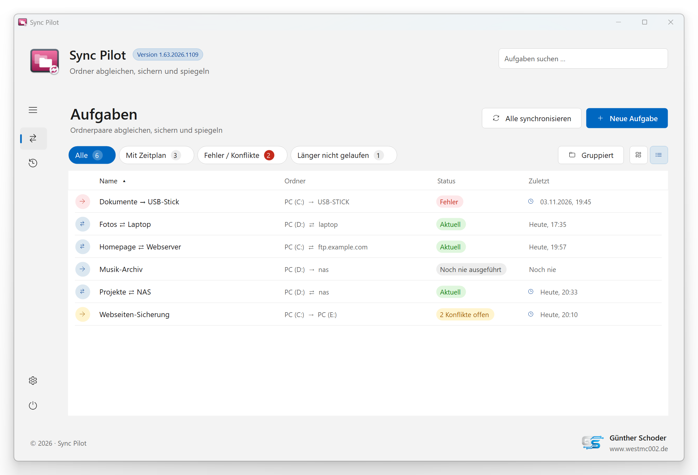 | 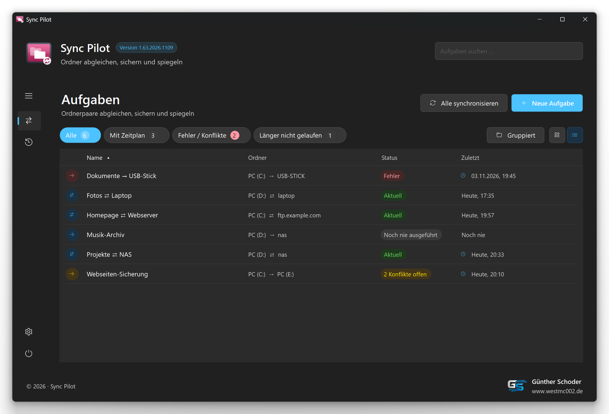 |

Weitere Screenshots

| Hell | Dunkel |
|---|---|
| 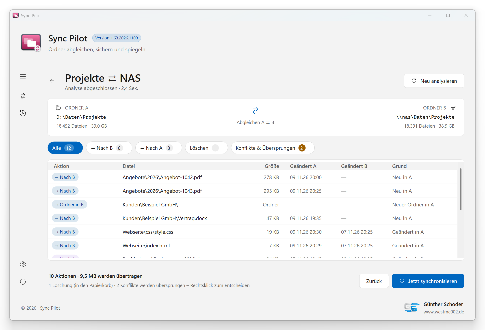 | 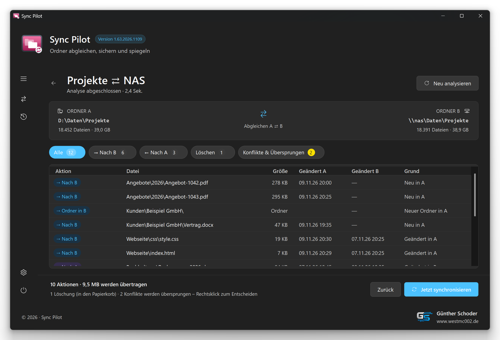 |
| 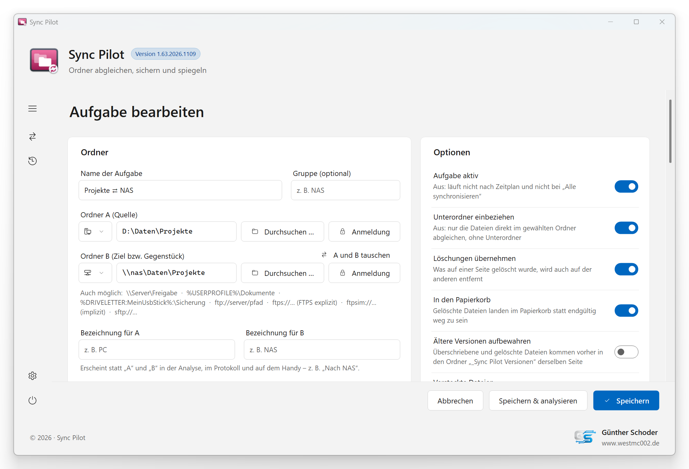 | 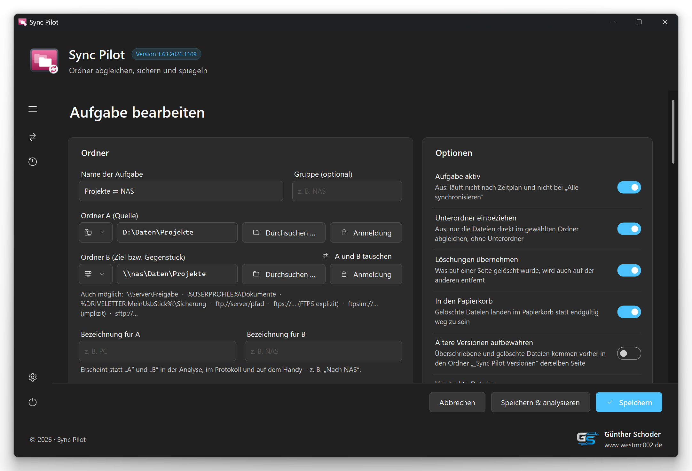 |
| 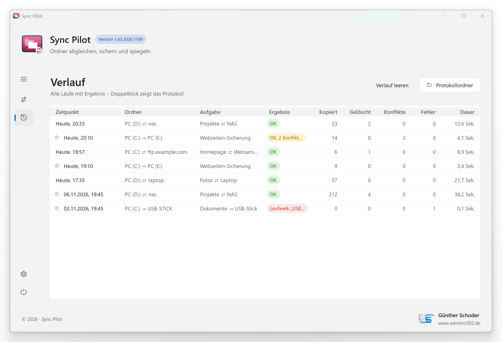 | 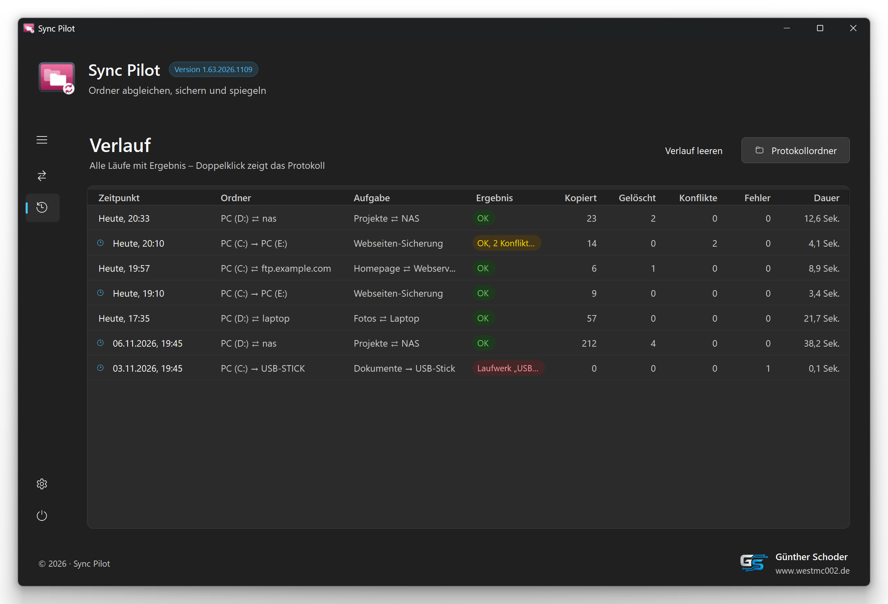 |
| 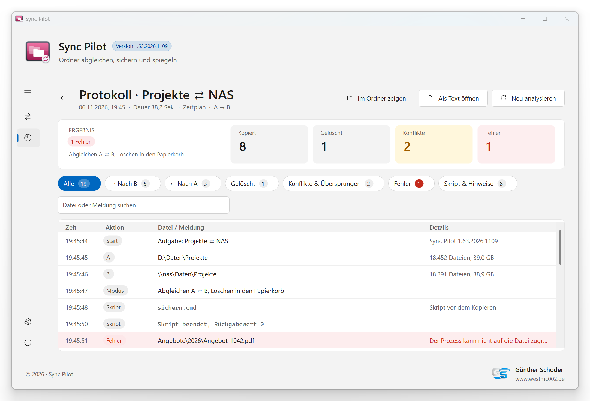 | 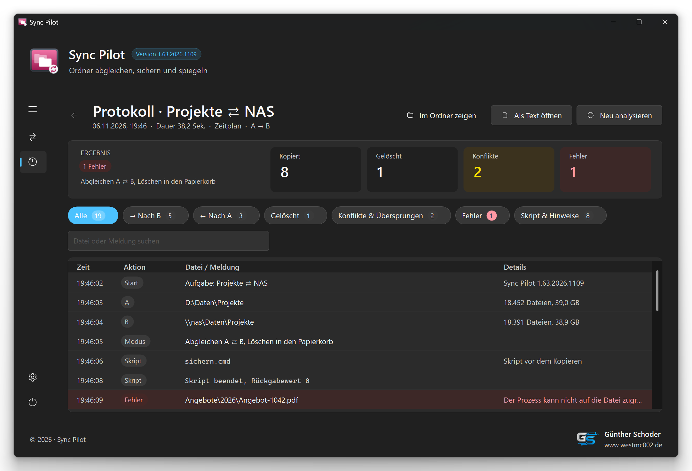 |
| 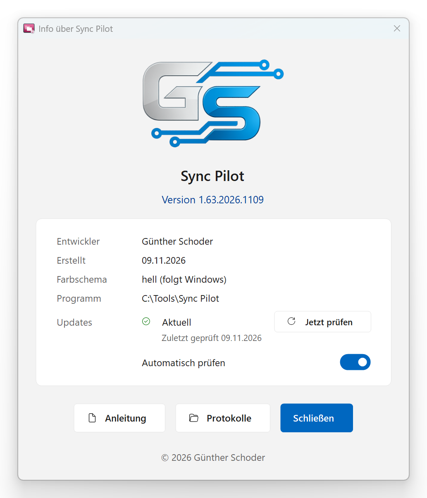 | 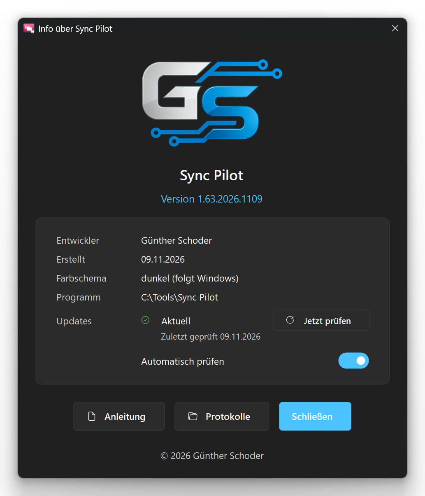 |

Die Screenshots zeigen erfundene Beispieldaten. Sie entstehen automatisch beim Erstellen (`"Sync Pilot.exe" --screenshots`).

## Funktionen

- **Drei Richtungen** je Aufgabe:
  - Abgleichen (A ⇄ B): Änderungen in beide Richtungen, Löschungen werden über den gespeicherten Stand des letzten Laufs erkannt
  - Sichern (A → B): neue und geänderte Dateien nach B, Löschungen nur auf Wunsch
  - Spiegeln (A → B): B wird exakt wie A
- **Analyse vor dem Abgleich** – zeigt jede geplante Aktion mit Filtern (Nach B, Nach A, Löschen, Konflikte); per Rechtsklick lässt sich jede Aktion ändern oder überspringen
- **Konflikte statt Überschreiben** – wurde eine Datei auf beiden Seiten geändert, entscheidet der Nutzer; fehlt der gespeicherte Stand oder ist er beschädigt, kommen gelöschte Dateien nicht einfach zurück, sondern Sync Pilot fragt nach
- **Umbenennen erkennen** – umbenannte und verschobene Dateien und Ordner werden auf der anderen Seite umbenannt statt neu kopiert
- **Viele Ziele** – lokale Ordner, Netzwerkfreigaben (auch mit eigener Anmeldung), Windows-Variablen (`%USERPROFILE%`), Laufwerke über ihren Namen (`%DRIVELETTER:MeinUsbStick%`), FTP, FTPS (explizit und implizit) und SFTP; Kennwörter verschlüsselt mit Windows-Bordmitteln
- **Filter** – Negativ- und Positivliste, je für Dateien und Ordner, mit Platzhaltern und festen Pfaden; Dateigröße als Filter
- **Optionen** – Löschungen übernehmen, Papierkorb statt endgültig löschen, versteckte Dateien, Inhalt vergleichen
- **Zeitplan** – feste Uhrzeiten mit Wochentagen oder alle x Minuten/Stunden, bei Anmeldung; verpasste Termine nachholen, ohne Verbindung still auslassen (über die Windows-Aufgabenplanung, läuft auch bei geschlossenem Programm)
- **Bei Ereignissen starten** – Änderungen in Ordner A oder B, Trigger-Datei, Ordner, Computer oder Laufwerk wird verfügbar; auf Wunsch höchstens alle x Stunden und nur, wenn sich etwas geändert hat
- **Steuerung per Handy** – Aufgaben und Verlauf als Webseite für Handy und Tablet (keine App nötig), Anmeldung per QR-Code oder Kennwort, optional verschlüsselt mit eigenem Zertifikat
- **Verlauf und Protokolle** – jeder Lauf mit Ergebnis; Protokolle übersichtlich mit Kacheln, Filtern, Suche und rot markierten Fehlern (auch auf dem Handy), Datei öffnen oder Inhalt vergleichen per Rechtsklick; Protokolle werden nach 30 Tagen gelöscht (einstellbar)
- **Weiteres** – Verknüpfungen für einzelne Aufgaben, Explorer-Kontextmenü, Hintergrundbetrieb im Infobereich, Start mit Windows, Update-Prüfung über GitHub mit „Jetzt aktualisieren“

## Installation

1. Unter [Releases](../../releases) die neueste `Sync-Pilot-<Version>.zip` herunterladen.
2. `Sync Pilot.exe` (und `Liesmich.txt`) in einen eigenen Ordner mit Schreibrechten entpacken, z. B. `C:\Tools\Sync Pilot`.
3. Starten, „Neue Aufgabe“ anlegen, Ordner A und B wählen und zuerst „Analysieren“ – erst danach synchronisieren.

Voraussetzungen: Windows 10 oder 11 mit .NET Framework 4.7.2 oder neuer – ist dort vorhanden.
Aufgaben, Stände und Protokolle liegen unter `%LOCALAPPDATA%\Sync Pilot`, der Programmordner bleibt unverändert.

## Selbst kompilieren

`Erstellen.bat` im Hauptordner ausführen. Sie nutzt den C#-Compiler aus dem .NET Framework 4, der bei Windows dabei ist – ein Visual Studio ist nicht nötig.
Die Version (Haupt.Neben.Jahr.MonatTag) wird dabei automatisch hochgezählt, die bisherige EXE wird unter `Backup` gesichert; auf Nachfrage werden die Screenshots in `Screenshots` neu erstellt.

## Projektaufbau

| Pfad | Inhalt |
|---|---|
| `Quellcode\` | C#-Quelldateien (WinForms, .NET Framework 4) und `app.manifest` |
| `Resources\` | Icon, GS-Logo, Beispieldaten `Demo.xml` für die Screenshots und die Handy-Webseite `Web\` (werden in die EXE eingebettet) |
| `Screenshots\` | Bilder für diese Seite, hell und dunkel (erzeugt die `Erstellen.bat`) |
| `Erstellen.bat` | Build-Skript |
| `Liesmich.txt` | Ausführliche Beschreibung und Versionsgeschichte |

## Lizenz

GNU General Public License v3.0 oder später – siehe [LICENSE](LICENSE).

Ausnahme: Das GS-Logo (`Resources\GS-Logo.png`) steht nicht unter dieser Lizenz. Alle Rechte vorbehalten; es darf nur unverändert zusammen mit dem Programm weitergegeben werden.

Dieses Projekt ist nicht mit Microsoft oder mit den Herstellern von Easy2Sync verbunden. Genannte Marken gehören ihren jeweiligen Inhabern.

## Autor

Günther Schoder · [www.westmc002.de](https://www.westmc002.de)
